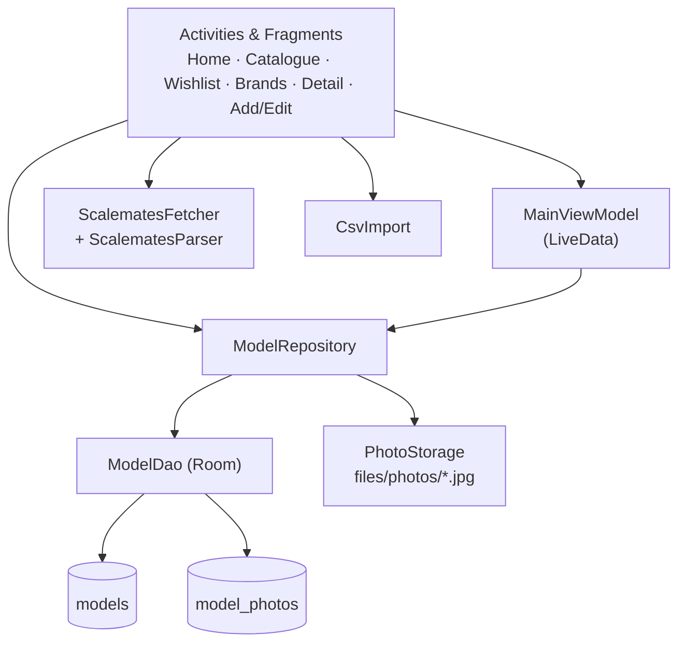

# Model Stash

**A personal Android app for cataloguing the scale model kits you own, and the ones you still want.**

Before you buy a kit, Model Stash answers one question in a second: *do I already have it?* It also keeps track of what you've built, what's on the bench and what's still sealed in its box, with up to six photos of every kit.

Everything stays on your phone. There's no account, no server and no ads.

[](https://github.com/SarthakBharad-AndroidStudio/model-stash/releases/tag/v1.5)

---

## Features

### Your stash
- **Add a kit in seconds:** name, scale, brand, kit number, description and photos. Only the name is required.
- **One-tap scales:** chips for 1:24, 1:35, 1:48, 1:72, 1:144, 1:350 and 1:700. Typed scales are tidied, so `72`, `1/72` and `1:72` all become `1:72`.
- **"Do I own it?" search:** the Catalogue searches name, kit number and brand as you type. A card answers clearly: *You own "…"*, *You don't own "…" yet* (with an **Add it** button that pre-fills the name), or how many kits partly match.
- **Sorting:** A–Z, Newest or Scale, largest models first.
- **Edit and delete** any kit. Deleting removes its photos too.

### Photos
- **Up to six photos per kit**, from the camera or the gallery. The gallery picks several at once.
- **Your own labels:** tag each photo **Box Art**, **Finished Build** or **Other**, or leave it unlabelled. The app never labels for you.
- **Arrange them:** hold and drag to reorder, or tap **Make cover**. The first photo is the cover every card shows.
- **Swipeable carousel** on the kit's page, with a badge (*Box Art · 2 of 4*) and page dots.
- Photos are copied into the app's private storage, so deleting them from your gallery doesn't affect the app.

### Build progress
- **Build status** for every owned kit: **Unbuilt**, **On the bench** or **Completed**.
- **Change it in two taps** from the kit's page, without opening the edit screen.
- **Filter the Catalogue by stage**, on top of search and sorting.
- **On the bench** row on the home screen, showing what you're working on now.

### Wishlist
- A **separate list** for kits you want to buy, with the same add screen, photos and import.
- **I bought it** moves a kit from the Wishlist into your stash, keeping its photos, notes and link.
- Wishlist kits stay out of the stash numbers and the search.

### Home dashboard
- **Your stash in numbers:** total kits (counting up when it changes), number of brands, most common scale, and kits added in the last 30 days.
- **Progress line:** *3 built · 1 on the bench*.
- **Every number leads somewhere:** tap the total for the full Catalogue, the top scale for a scale-sorted list, *Last 30 days* for newest first, or **Brands** for every brand with its kits underneath.
- **Recently added** carousel.

### Importing
- **Scalemates link import:** share a Scalemates kit page from your browser to Model Stash, or paste the link. The app reads that one page and fills in name, kit number, brand and scale. [Why only a link?](#why-scalemates-is-a-link-import)
- **CSV import** for a whole list at once. [Format below](#csv-import).
- Manual entry always works too, including for small-batch kits that aren't listed anywhere.

### Look and feel
- **Two themes:** *Midnight* (dark, the default) and *Paper* (light), or **Follow system**.
- **Full-screen wipe transitions:** every new screen slides in from the right over the current one, and back slides it away again. Tabs wipe in from the side they sit on in the bottom bar.
- **Natural navigation:** back on Catalogue or Wishlist returns to Home. Tapping the tab you're already on scrolls it to the top.
- **Small touches:** cards shrink slightly when pressed, light haptic ticks, a + button that shrinks while you scroll, and a splash screen with the app's logo.
- Edge-to-edge layout and an adaptive, themed launcher icon (Android 13+).

---

## Screenshots

| Home | Catalogue | Kit page | Add / edit |
| --- | --- | --- | --- |
| *add screenshot* | *add screenshot* | *add screenshot* | *add screenshot* |

---

## Tech stack

| | |
| --- | --- |
| Language | Java |
| Min SDK | 26 (Android 8.0) |
| UI | Material Components 3, ViewPager2, RecyclerView |
| Data | Room (SQLite), LiveData, ViewModel |
| Images | Glide |
| Splash | AndroidX Core SplashScreen |
| Tests | JUnit 4 (plain JVM unit tests) |

---

## Architecture



- Screens never touch the database directly. They go through `ModelRepository`, which does all writes on a background thread.
- Queries return `LiveData`, so every list updates itself when the data changes.
- A kit and its photos are saved in **one transaction**. Photo files are deleted only after the database write succeeds, so a crash can't lose a photo that's still in use.
- `models.photo_path` always mirrors the cover photo, so every card shows a photo without an extra query.

---

## Project structure

```
app/src/main/java/com/sarthak/modelstash/
├── MainActivity.java            Home screen: toolbar, tabs, + button, back-to-Home, CSV import
├── ModelStashApp.java           Applies the saved theme; sets the wipe transition on every screen
├── data/
│   ├── ModelKit.java            Entity: one kit
│   ├── ModelPhoto.java          Entity: one photo of a kit (path, label, position)
│   ├── ModelDao.java            Every query
│   ├── AppDatabase.java         Room database + migrations
│   └── ModelRepository.java     The single entry point the screens use
├── scalemates/
│   ├── KitInfo.java
│   ├── ScalematesParser.java    Reads one kit page's title and description
│   └── ScalematesFetcher.java   Downloads that one page
├── ui/
│   ├── MainViewModel.java
│   ├── DashboardFragment.java   Home tab
│   ├── CatalogueFragment.java   Search, sort, stage filter, "do I own it?"
│   ├── WishlistFragment.java
│   ├── BrandsActivity.java      Every brand, expandable to its kits
│   ├── ModelDetailActivity.java Photo carousel and details
│   ├── AddEditModelActivity.java
│   ├── ModelAdapter.java, BrandAdapter.java
│   ├── PhotoStripAdapter.java   Photo tiles on the edit screen
│   └── PhotoPagerAdapter.java   Carousel pages
└── util/
    ├── BuildStatus.java, PhotoLabel.java, PhotoDraft.java
    ├── ScaleFormat.java, ModelSort.java, StashStats.java, BrandGroups.java
    ├── CsvImport.java, PhotoStorage.java
    └── ThemePrefs.java, Haptics.java, InsetsHelper.java
```

---

## Database

The database is called `model_stash.db` and is at **version 5**. Every schema change comes with a Room migration, so updating the app never wipes your stash.

| Version | Change |
| --- | --- |
| 1 | `models` table |
| 2 | `wishlist` flag |
| 3 | `kit_number` |
| 4 | `build_status` (0 Unbuilt, 1 On the bench, 2 Completed) |
| 5 | `model_photos` table: up to six photos per kit, each with a label and position. The photo each kit already had becomes its unlabelled cover. |

Photos are stored as **files** in the app's private folder. The database keeps only their paths, so it stays small and fast.

---

## CSV import

Use the **Import CSV** button in the toolbar. The importer reads four columns:

```csv
name,number,brand,scale
Russian Heavy Tank JS-2 Model 1944 ChKZ,32571,Tamiya,1:48
```

- Only `name` is required. Rows without a name are skipped.
- With a header row the columns can be in any order, and common spellings work: *Kit No.*, *Kit number*, *Model number*, *Manufacturer*, *Maker*, *Ratio*, *Size*.
- Without a header, the order `name, number, brand, scale` is assumed.
- Any other column (price, notes, …) is ignored, so you can use a spreadsheet you already keep.
- Quoted commas, semicolons (German Excel) and Windows line endings all work.
- Importing on the **Wishlist** tab fills the wishlist; anywhere else fills your stash.
- An import only ever adds kits. It never overwrites existing ones.

---

## Why Scalemates is a link import

Scalemates has no public API. Its `robots.txt` blocks automated access to search, its AJAX endpoints and its product images. So Model Stash never searches or copies their catalogue. It loads **one public kit page**, only when you share or paste its link, reads the page title and description, and identifies itself with an honest User-Agent. It never downloads box art; the photos are yours to add.

---

## Getting started

### Requirements
- Android Studio (a recent stable version)
- An Android phone or emulator running Android 8.0 or later

### Build and run
1. Clone the repository:
   ```bash
   git clone https://github.com/SarthakBharad-AndroidStudio/model-stash.git
   ```
2. Open the folder in Android Studio and let Gradle sync.
3. Press **Run ▶**.

Debug builds install as a separate app (`com.sarthak.modelstash.debug`) with their own empty database, so testing never touches your real collection.

### Release build
**Build → Generate Signed App Bundle or APK… → APK**, signed with your own key. Keep the `.jks` file and its passwords outside the repository and backed up. Every future update must be signed with the same key.

---

## Tests

Plain JVM unit tests for the logic that doesn't need a phone: scale parsing, Scalemates page parsing, stats and sorting, the CSV importer and the photo list (six-photo limit, cover, reordering, labels).

In Android Studio, right-click `app/src/test/java` → **Run 'Tests in …'**, or from the terminal:

```bash
./gradlew test
```

On Windows PowerShell, use `.\gradlew test`.

---

## Credits

- Inspired by [Model Workshop Manager](https://github.com/Lucifix/model-workshop-manager), slimmed down to just tracking the kits you own.
- Fonts: **Tanker** (app name), **Quilon** (headings) and **Satoshi** (text), from [Fontshare](https://www.fontshare.com/). Check each font's licence before publishing the app.
- Kit details via [Scalemates](https://www.scalemates.com/), one page at a time, only on request.

---

Made by Sarthak.
