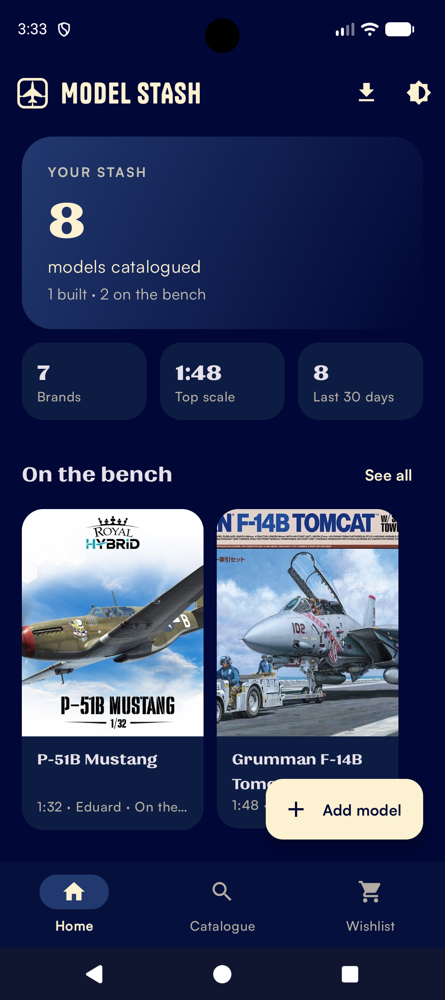
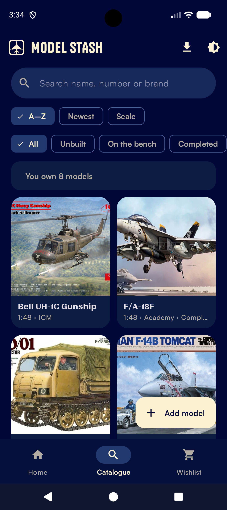
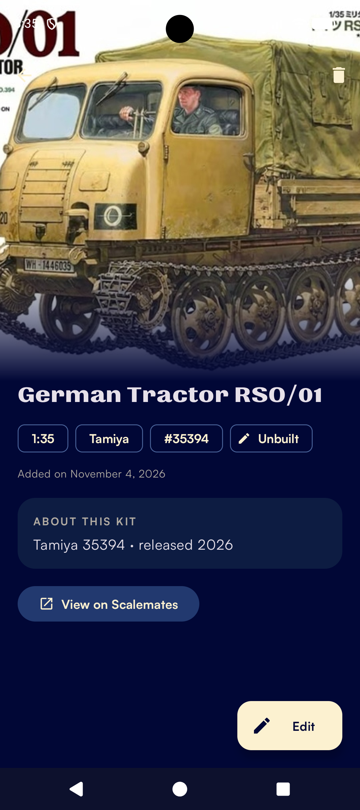
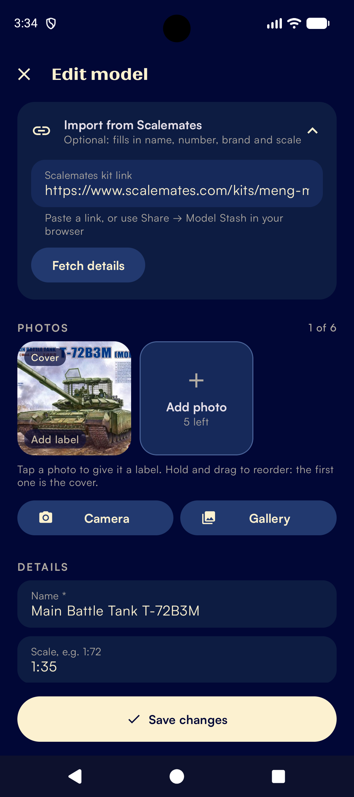
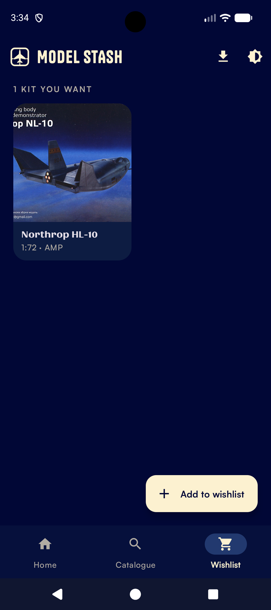
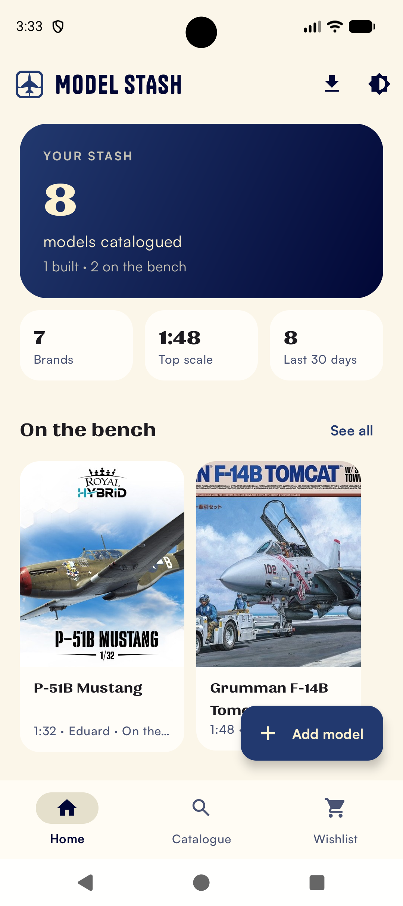
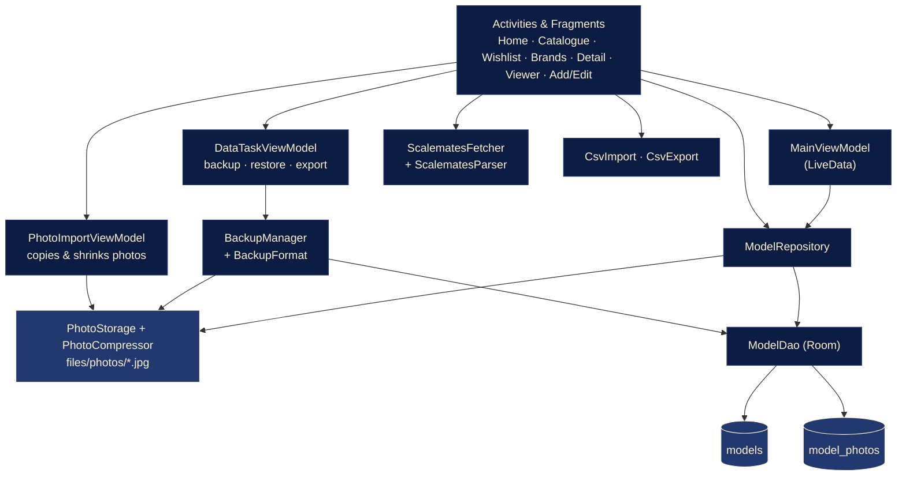

<div align="center">

# ✈️ Model Stash

**A personal Android app for cataloguing the scale model kits you own, and the ones you still want.**

<a href="https://github.com/SarthakBharad-AndroidStudio/model-stash/releases/latest"></a>


[Download](#-download) · [What's new](#-whats-new-in-16) · [Features](#-features) · [Screenshots](#-screenshots) · [Backups](#-backup--restore) · [Getting started](#-getting-started)

</div>

---

Before you buy a kit, Model Stash answers one question in a second: ***do I already have it?*** It also keeps track of what you've built, what's on the bench and what's still sealed in its box, with up to six photos of every kit.

> [!NOTE]
> 🔒 **Everything stays on your phone.** There's no account, no server, no ads and no analytics. The app only goes online when you import a Scalemates link, and your backups go only where you choose to save them.

---

## 🆕 What's new in 1.6

| | |
| --- | --- |
| 💾 **Backup & restore** | One `.zip` with every kit and photo, saved wherever you like (Drive, Downloads, a PC). Restore it on the same or a new phone. |
| 📊 **Spreadsheet export** | Your whole stash and wishlist as a CSV that opens in Excel, LibreOffice or Google Sheets. |
| 🗜️ **Smaller photos** | Photos are shrunk to at most 2560 px as they're added (about 0.5 MB instead of 4–8 MB), and turned the right way up. *Shrink stored photos* does the same for the ones you already have. |
| ⚠️ **"You may already have this kit"** | Saving a kit that matches one in your stash or wishlist (same brand and kit number, or same name at the same scale) asks before adding a duplicate. |
| ✋ **Discard changes?** | Leaving the add/edit screen with unsaved changes asks first. Leaving without changes closes straight away. |
| 🔍 **Full-screen photo viewer** | Tap a photo on a kit's page: full screen on black, pinch or double-tap to zoom in on box details, swipe between photos. |
| ↩️ **Undo delete** | Deleting is instant, and *Deleted "…" · UNDO* brings the kit back with all its photos. |
| 🚀 **App icon shortcuts** | Long-press the icon for **Search**, **Add kit** and **Wishlist**. *Search* opens the Catalogue with the keyboard up, the fastest "do I own this?" in a shop. |
| ☑️ **Multi-select** | Hold a card to select several kits, then set their build status, move them to your stash, or delete them at once. |
| 🛠️ **Gallery import fix** | Adding several photos from the gallery no longer crashes the app. Photos that can't be read are skipped with a message, copying survives rotating the phone, and the picker only lets you pick as many as still fit. |

---

## 📸 Screenshots

| Dashboard | Catalogue | Kit Details |
| :---: | :---: | :---: |
|  |  |  |
| **Add / Edit** | **Wishlist** | **Light Mode** |
|  |  |  |

---

## 📥 Download

Model Stash isn't on the Play Store. Each version is published as a signed APK on the **[Releases page](https://github.com/SarthakBharad-AndroidStudio/model-stash/releases/latest)**.

| | |
| --- | --- |
| 🏷️ **Latest version** | **1.6** |
| 📦 **File** | `model-stash-v1.6.apk` |
| 📱 **Requires** | Android 8.0 or later |
| 🆔 **Package** | `com.sarthak.modelstash` |

### Install
1. On your Android phone, open the [latest release](https://github.com/SarthakBharad-AndroidStudio/model-stash/releases/latest) and download the `.apk` under **Assets**.
2. Open the downloaded file. If Android asks, allow your browser to **install unknown apps**.
3. Tap **Install**. If Play Protect warns about an unknown developer, tap **More details → Install anyway**.

### Update
Download the newer APK from the Releases page and install it over the existing app. Your kits and photos are kept.

> [!WARNING]
> **Don't uninstall first.** Uninstalling deletes the app's database and photos. Since 1.6 you can make a backup first (**Backup & data → Back up now**) to be safe.

---

## ✨ Features

### 📦 Your stash
- **Add a kit in seconds:** name, scale, brand, kit number, description and photos. Only the name is required.
- **One-tap scales:** chips for 1:24, 1:35, 1:48, 1:72, 1:144, 1:350 and 1:700. Typed scales are tidied, so `72`, `1/72` and `1:72` all become `1:72`.
- **"Do I own it?" search:** the Catalogue searches name, kit number and brand as you type. A card answers clearly: *You own "…"*, *You don't own "…" yet* (with an **Add it** button that pre-fills the name), or how many kits partly match.
- **Duplicate warning:** saving a kit you already have (same brand and kit number, or same name at a matching scale) shows *You may already have this kit*, with **Save anyway**, **Open it** or **Cancel**. A 1/48 and a 1/72 Tomcat count as different kits.
- **Sorting:** A–Z, Newest or Scale, largest models first.
- **Multi-select:** hold a card in the Catalogue or Wishlist to start selecting, then tap more. The toolbar turns into *3 selected* with **Select all**, **Set build status**, **Move to stash** (Wishlist) and **Delete**.
- **Delete with undo:** deleting is instant, and *Deleted "…" · UNDO* gives you a few seconds to bring the kit back with all its photos.
- **Never lose an edit by accident:** leaving the add/edit screen with unsaved changes asks *Discard changes?*

### 🖼️ Photos
- **Up to six photos per kit**, from the camera or the gallery. The gallery picks several at once, and only as many as still fit.
- **Your own labels:** tag each photo **Box Art**, **Finished Build** or **Other**, or leave it unlabelled. The app never labels for you.
- **Arrange them:** hold and drag to reorder, or tap **Make cover**. The first photo is the cover every card shows.
- **Swipeable carousel** on the kit's page, with a badge (*Box Art · 2 of 4*) and page dots.
- **Full-screen viewer:** tap a photo on the kit's page. Pinch or double-tap to zoom in (up to 5×), drag to look around, swipe between photos, tap to hide the controls.
- **Sensible sizes:** photos are stored at most 2560 px on their long side (about 0.5 MB each) and always upright. They stay sharp on a phone screen, and a stash of 50 kits with 6 photos each takes around 150 MB instead of a few GB.
- **Robust import:** photos that can't be read (a cloud photo not yet on the phone, a file that isn't a picture) are skipped with a message instead of crashing. *Adding 3 photos…* shows while they copy, and rotating the phone doesn't lose them.
- Photos are copied into the app's private storage, so deleting them from your gallery doesn't affect the app.

### 🛠️ Build progress
- **Build status** for every owned kit: **Unbuilt**, **On the bench** or **Completed**.
- **Change it in two taps** from the kit's page, or for many kits at once with multi-select.
- **Filter the Catalogue by stage**, on top of search and sorting.
- **On the bench** row on the home screen, showing what you're working on now.

### 🛒 Wishlist
- A **separate list** for kits you want to buy, with the same add screen, photos and import.
- **I bought it** moves a kit from the Wishlist into your stash, keeping its photos, notes and link. Select several to move them all at once.
- Wishlist kits stay out of the stash numbers and the search.

### 📊 Home dashboard
- **Your stash in numbers:** total kits (counting up when it changes), number of brands, most common scale, and kits added in the last 30 days.
- **Progress line:** *3 built · 1 on the bench*.
- **Every number leads somewhere:** tap the total for the full Catalogue, the top scale for a scale-sorted list, *Last 30 days* for newest first, or **Brands** for every brand with its kits underneath.
- **Recently added** carousel.

### 💾 Backup & data
Tap the ☁️ icon in the toolbar to open **Backup & data**:
- **Back up now:** every kit and photo in one `.zip`, saved wherever you choose. The menu shows when you last backed up.
- **Restore from a backup:** shows what's in the file (date, number of kits and photos) and asks before replacing anything. [More below](#-backup--restore).
- **Export as spreadsheet (CSV)** and **Import from spreadsheet (CSV)**.
- **Shrink stored photos:** brings photos added before 1.6 down to the new size and reports how much space it freed.

### 🔗 Importing
- **Scalemates link import:** share a Scalemates kit page from your browser to Model Stash, or paste the link. The app reads that one page and fills in name, kit number, brand and scale. [Why only a link?](#-why-scalemates-is-a-link-import)
- **CSV import** for a whole list at once. [Format below](#-csv-import--export).
- Manual entry always works too, including for small-batch kits that aren't listed anywhere.

### 🚀 Shortcuts
Long-press the app icon (or drag a shortcut onto your home screen):
- **Search:** opens the Catalogue with the search field focused and the keyboard up.
- **Add kit** and **Wishlist:** go straight to the add screen. Back lands in the app.

### 🎨 Look and feel
- **Two themes:** *Midnight* (dark, the default) and *Paper* (light), or **Follow system**.
- **Full-screen wipe transitions:** every new screen slides in from the right over the current one, and back slides it away again. Tabs wipe in from the side they sit on in the bottom bar.
- **Natural navigation:** back on Catalogue or Wishlist returns to Home; back while selecting clears the selection. Tapping the tab you're already on scrolls it to the top.
- **Small touches:** cards shrink slightly when pressed, light haptic ticks, a + button that shrinks while you scroll, and a splash screen with the app's logo.
- Edge-to-edge layout and an adaptive, themed launcher icon (Android 13+).

---

## 💾 Backup & restore

A backup is an ordinary `.zip` file you keep wherever you like:

```
model-stash-backup-2026-11-18.zip
├── backup.properties   app version, date, number of kits and photos
├── kits.csv            every kit and every field (opens in any spreadsheet)
├── photos.csv          which photo belongs to which kit, its label and position
└── photos/             the photo files
```

- **Restoring replaces everything** on the phone with the backup's kits and photos. It never merges, and the app says so and asks before it starts.
- **It's careful:** the whole file is read and checked first, and the photos are put in place before the database is swapped in a single step. If anything is wrong (not a backup, damaged, made by a newer version), you get a message and **nothing on the phone changes**.
- **It's future-proof:** columns are read by name, so backups from older versions restore in newer ones, and the other way round. Fields a version doesn't know about are simply skipped.
- **Moving to a new phone:** back up on the old phone, install Model Stash on the new one, then **Restore from a backup**.

> [!TIP]
> Make a backup after a big session of adding kits. With the photos at their new size, a backup of 50 kits is around 150 MB.

**Android's own backup:** Model Stash also lets Android's automatic Google backup save your kit list and settings, but not the photos: Google limits each app to 25 MB. A direct phone-to-phone transfer ("copy apps and data" when setting up a new phone) includes the photos too. For a complete backup that you control, use **Backup & data**.

---

## 📄 CSV import & export

### Export
**Backup & data → Export as spreadsheet (CSV)** writes every kit, stash first and then wishlist, A–Z:

```csv
name,number,brand,scale,status,list,description,link,added
Grumman F-14D Tomcat,61114,Tamiya,1:48,On the bench,Stash,,https://www.scalemates.com/kits/…,2026-11-02
```

The file is UTF-8 with a byte-order mark, so Excel shows umlauts and accents correctly. An exported file can be imported again.

### Import
**Backup & data → Import from spreadsheet (CSV)** reads four columns:

```csv
name,number,brand,scale
Russian Heavy Tank JS-2 Model 1944 ChKZ,32571,Tamiya,1:48
```

- Only `name` is required. Rows without a name are skipped.
- With a header row the columns can be in any order, and common spellings work: *Kit No.*, *Kit number*, *Model number*, *Manufacturer*, *Maker*, *Ratio*, *Size*.
- Without a header, the order `name, number, brand, scale` is assumed.
- Any other column (price, notes, …) is ignored, so you can use a spreadsheet you already keep.
- Quoted commas, semicolons (German Excel) and Windows line endings all work.
- Importing on the **Wishlist** tab fills the wishlist; anywhere else fills your stash.

> [!TIP]
> An import only ever adds kits. It never overwrites existing ones, so it's safe to run again.

---

## 🧰 Tech stack

| | |
| --- | --- |
| **Language** | Java |
| **Min SDK** | 26 (Android 8.0) |
| **UI** | Material Components 3, ViewPager2, RecyclerView |
| **Data** | Room (SQLite), LiveData, ViewModel |
| **Images** | Glide; photo shrinking with Android's own `BitmapFactory` |
| **Files** | Storage Access Framework (backup, restore, CSV), photo picker |
| **Splash / shortcuts** | AndroidX Core SplashScreen, ShortcutManagerCompat |
| **Tests** | JUnit 4 (JVM unit tests) and AndroidX instrumented tests |

No new libraries were added in 1.6: zip files, CSV, photo shrinking and the zoom viewer use plain Java and the Android SDK.

---

## 🏗️ Architecture



- Screens never touch the database directly. They go through `ModelRepository`, which does all writes on a background thread.
- Queries return `LiveData`, so every list updates itself when the data changes, including after a restore.
- A kit and its photos are saved in **one transaction**. Photo files are deleted only after the database write succeeds, so a crash can't lose a photo that's still in use.
- **Long jobs live in ViewModels** (photo copying, backups), so they keep running and report back when the screen rotates.
- **Undo delete** keeps the photo files until the undo chance has passed. A tidy-up at start-up removes files that nothing refers to any more, but only ones older than a day.
- `models.photo_path` always mirrors the cover photo, so every card shows a photo without an extra query.

---

## 📁 Project structure

<details>
<summary><b>Show the source tree</b></summary>

```
app/src/main/java/com/sarthak/modelstash/
├── MainActivity.java            Home screen: toolbar, tabs, + button, selection bar, Backup & data menu
├── ModelStashApp.java           Theme, wipe transitions, launcher shortcuts, photo tidy-up
├── backup/
│   ├── BackupFormat.java        What goes inside a backup .zip, and how it's read back
│   └── BackupManager.java       Back up, restore, CSV export, shrink stored photos
├── data/
│   ├── ModelKit.java            Entity: one kit
│   ├── ModelPhoto.java          Entity: one photo of a kit (path, label, position)
│   ├── ModelDao.java            Every query
│   ├── AppDatabase.java         Room database + migrations
│   └── ModelRepository.java     The single entry point the screens use (incl. undo delete)
├── scalemates/
│   ├── KitInfo.java
│   ├── ScalematesParser.java    Reads one kit page's title and description
│   └── ScalematesFetcher.java   Downloads that one page
├── ui/
│   ├── MainViewModel.java
│   ├── DashboardFragment.java   Home tab
│   ├── CatalogueFragment.java   Search, sort, stage filter, "do I own it?", multi-select
│   ├── WishlistFragment.java    Wishlist, multi-select
│   ├── KitSelection.java        The selection bar's actions
│   ├── BrandsActivity.java      Every brand, expandable to its kits
│   ├── ModelDetailActivity.java Photo carousel and details
│   ├── PhotoViewerActivity.java Full-screen photos
│   ├── ZoomImageView.java       Pinch, drag and double-tap zoom
│   ├── AddEditModelActivity.java  Add/edit, duplicate warning, discard check
│   ├── PhotoImportViewModel.java  Copies and shrinks picked photos in the background
│   ├── DataTaskViewModel.java     Runs backup / restore / export / shrink
│   ├── UndoDeleteSnackbar.java    "Deleted … · UNDO"
│   ├── ModelAdapter.java, BrandAdapter.java
│   ├── PhotoStripAdapter.java   Photo tiles on the edit screen
│   └── PhotoPagerAdapter.java   Carousel pages
└── util/
    ├── BuildStatus.java, PhotoLabel.java, PhotoDraft.java
    ├── ScaleFormat.java, ModelSort.java, StashStats.java, BrandGroups.java
    ├── CsvImport.java, CsvExport.java, CsvTable.java
    ├── DuplicateFinder.java, FormSnapshot.java
    ├── PhotoStorage.java, PhotoCompressor.java, ImageSizing.java
    ├── AppShortcuts.java
    └── ThemePrefs.java, Haptics.java, InsetsHelper.java
```

</details>

---

## 🗄️ Database

The database is called `model_stash.db` and is at **version 5**. Every schema change comes with a Room migration, so updating the app never wipes your stash.

| Version | Change |
| :---: | --- |
| 1 | `models` table |
| 2 | `wishlist` flag |
| 3 | `kit_number` |
| 4 | `build_status` (0 Unbuilt, 1 On the bench, 2 Completed) |
| 5 | `model_photos` table: up to six photos per kit, each with a label and position. The photo each kit already had becomes its unlabelled cover. |

Version 1.6 needed no schema change. Photos are stored as **files** in the app's private folder. The database keeps only their paths, so it stays small and fast.

---

## 🌐 Why Scalemates is a link import

Scalemates has no public API. Its `robots.txt` blocks automated access to search, its AJAX endpoints and its product images. So Model Stash never searches or copies their catalogue. It loads **one public kit page**, only when you share or paste its link, reads the page title and description, and identifies itself with an honest User-Agent. It never downloads box art; the photos are yours to add.

---

## 🚀 Getting started

### Requirements
- Android Studio (a recent stable version)
- An Android phone or emulator running Android 8.0 or later

### Build and run
1. Clone the repository:
   ```bash
   git clone https://github.com/SarthakBharad-AndroidStudio/model-stash.git
   ```
2. Open the folder in Android Studio and let Gradle sync.
3. Press **Run ▶**.

> [!NOTE]
> Debug builds install as a separate app (`com.sarthak.modelstash.debug`) with their own empty database, so testing never touches your real collection.

### Release build
1. Raise `versionCode` (by 1) and `versionName` in `app/build.gradle.kts`.
2. **Build → Generate Signed App Bundle or APK… → APK**, build variant **release**, signed with your own key.
3. The APK is written to `app/build/outputs/apk/release/app-release.apk`. Copy it out and rename it, e.g. `app/release/model-stash-v1.6.apk` (`app/release/` is git-ignored).
4. Commit and push the version bump, then create a GitHub release tagged `vX.Y` on `main` with the APK attached.

> [!IMPORTANT]
> Keep the `.jks` file and its passwords outside the repository and backed up. Every future update must be signed with the same key, or Android won't install it over the old version.

---

## 🏷️ Releases

| Version | Date | Notes |
| :---: | :---: | --- |
| [**1.6**](https://github.com/SarthakBharad-AndroidStudio/model-stash/releases/tag/v1.6) | November 2026 | Backup & restore, CSV export, smaller photos (plus *Shrink stored photos*), duplicate warning, *Discard changes?*, full-screen photo viewer with zoom, undo delete, app icon shortcuts, multi-select, and a fix for crashes when adding several photos from the gallery. |
| [**1.5**](https://github.com/SarthakBharad-AndroidStudio/model-stash/releases/tag/v1.5) | November 2026 | First public release on GitHub: catalogue, wishlist, build status, photo carousel with labels, Scalemates link import, CSV import, Midnight and Paper themes. |

---

## 🧪 Tests

**JVM unit tests** (no phone needed) cover the logic: scale parsing, Scalemates page parsing, stats and sorting, the CSV importer and exporter, the backup file format (round trip, newer and older versions, unsafe file names), the duplicate rules, the unsaved-changes check, photo sizing, and the photo list (six-photo limit, cover, reordering, labels).

In Android Studio, right-click `app/src/test/java` → **Run 'Tests in …'**, or from the terminal:

```bash
./gradlew test
```

On Windows PowerShell, use `.\gradlew test`.

**Instrumented tests** (on a phone or emulator) check:

- **Backup and restore:** a full round trip, plus refusing a file that isn't a backup. It uses a throw-away database, never your collection.
- **Photo shrinking.**
- **Gallery import:** good photos arrive, bad ones are skipped, and nothing is left behind.

Right-click `app/src/androidTest/java` → **Run**.

---

## 🙏 Credits

- Inspired by [Model Workshop Manager](https://github.com/Lucifix/model-workshop-manager), slimmed down to just tracking the kits you own.
- Fonts: **Tanker** (app name), **Quilon** (headings) and **Satoshi** (text), from [Fontshare](https://www.fontshare.com/).
- Kit details via [Scalemates](https://www.scalemates.com/), one page at a time, only on request.

---

<div align="center">

Made by **Sarthak** · Released under the [MIT License](LICENSE)

</div>